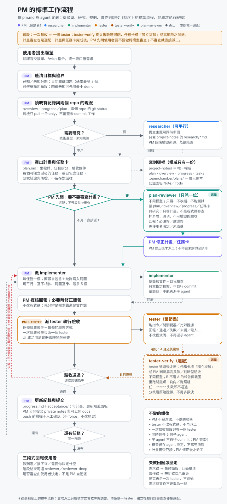

# my-agent-skills

`j7708git/my-agent-skills` 是一個 [Agent Skills](https://agentskills.io/specification) 集合 repo。
目前提供九個 skill：

- **`repo-privacy-audit`** —— 對 Git repo 做唯讀的隱私與秘密掃描，
  並附上明確安裝的 hooks、CI 範本與修復手冊。
- **`project-workflow`** —— 引導「公開程式碼 repo」與「獨立 private 工作紀錄 repo」
  的規劃、拆工、驗收與同步流程。它只是**流程指引**，不是掃描器，
  也不會自行建立 repo、push、安裝 hooks 或搬移檔案。
- **`web-ui-e2e-smoke`** —— 把「真實建置的 Web UI ＋ 可達後端 ＋ 真實瀏覽器驅動
  ＋ 截圖留證」的端到端冒煙驗收固定成可重複的步驟。
- **`independent-rerun-verify`** —— 驗收時自行建置、自行重跑，不採信實作方產物，
  並以對照組證明斷言真的抓得到 bug。
- **`review-fix-round`** —— 「findings 分級 → 逐項裁決 → 限定範圍修復 → 驗收 →
  複審 → 裁決紀錄」的審查修復輪協定。
- **`academic-paper-search`** —— 以 arXiv 官方 API 做結構化論文檢索，
  輸出 `json`／`text`／`bibtex`；只做檢索，不下載或解析全文。
- **`native-crash-triage`** —— 原生崩潰報告（macOS `.ips`、診斷 JSON、Apple 崩潰全文）
  的證據處理流程：去識別、符號還原、跨案比對、機制驗證與分層筆記。
- **`release-prep`** —— 發版整備清單：版本號同源、文件同步、本地基準、掃描、
  標籤、CI、Release 驗證與發版紀錄。
- **`handoff-refresh`** —— 交接與現況文件的重生對帳：以進度紀錄與兩個 repo 的 Git 事實
  逐條比對交接檔、總覽與計畫的宣稱，只改「現況／下一步」段並回報差異。

這個 repo 不做自動修復，也不替你決定任何不可逆的動作。它只負責**看清楚**、**講明白**。

`skills/` 之外另有選配的 **`adapters/opencode/`**：`project-workflow` 配套的
OpenCode agent 定義（`pm`／`researcher`／`implementer`／`tester`／可選的
獨立複驗 `tester-verify`、派工前的選配計畫審查 `plan-reviewer`、獨立審查者
`reviewer`／`reviewer-deep`、`workflow-optimizer` 健檢、把抽象願望整理成
brief 的 `translator` 翻譯官）、獨立的 `web-search`
agent，與 `/wish`／`/proto`／`/research`／`/optimize` 指令。發行版本已移除所有模型綁定，
安裝者依自己環境自選。格式層面僅保證 OpenCode（`pm`／`implementer`／`translator`
的部分指引另假設 OpenChamber 提供的工具），說明見
[adapters/opencode/README.md](adapters/opencode/README.md)。

> **狀態**：授權採 MIT。`repo-privacy-audit` 已驗證項目包括格式與相對資源、
> 四種隔離安裝、真實 hooks 與完整密鑰掃描；CI runner 執行全部測試、無 skipped。
> `project-workflow` 是純文字流程指引，已驗證格式與相對資源。
> skill 檔案通過驗證與安裝測試，**不代表 agent runtime 一定會載入並使用**。
> `academic-paper-search` 的路由已在 OpenChamber 環境實測（2026-10-15）：researcher
> subagent 的 skill 清單含本 skill、`skill` 工具載入成功、`scripts/arxiv_search.py`
> 兩次 API 呼叫均成功；web-search agent 為 subagent 模式無法直接派發，依同一 skill
> 發現機制推定可見，**未單獨實測**。**其餘七個 skill 的 agent runtime 尚未實測。**
> 逐項的可宣稱／不可宣稱範圍見 [docs/compatibility.md](docs/compatibility.md)；
> 產品行為契約：掃描器見 [docs/specification.md](docs/specification.md)，
> 流程指引見 [docs/project-workflow.md](docs/project-workflow.md)。

GitHub 設定檢查仍可能因方案／權限不足回報 incomplete；這與本機內容掃描及 CI 通過是不同的範圍，
不要把其中一項的通過當成另一項的通過。

## 目錄

- [快速開始](#快速開始)
- [project-workflow（流程指引）](#project-workflow流程指引)
- [web-ui-e2e-smoke（Web UI 端到端冒煙）](#web-ui-e2e-smokeweb-ui-端到端冒煙)
- [independent-rerun-verify（獨立重跑驗證）](#independent-rerun-verify獨立重跑驗證)
- [review-fix-round（審查修復輪）](#review-fix-round審查修復輪)
- [academic-paper-search（學術論文檢索）](#academic-paper-search學術論文檢索)
- [native-crash-triage（原生崩潰歸因）](#native-crash-triage原生崩潰歸因)
- [release-prep（發版整備）](#release-prep發版整備)
- [handoff-refresh（交接與現況對帳）](#handoff-refresh交接與現況對帳)
- [OpenCode agent adapters](#opencode-agent-adapters)
- [安裝 skill](#安裝-skill)
- [使用掃描器](#使用掃描器)
- [退出碼怎麼讀](#退出碼怎麼讀)
- [hooks 要自己裝](#hooks-要自己裝)
- [在 CI 使用](#在-ci-使用)
- [這個 repo 自己的 CI](#這個-repo-自己的-ci)
- [驗證與品質](#驗證與品質)
- [文件索引](#文件索引)
- [授權](#授權)

## 快速開始

```bash
# 1. 取出這個 repo（會用到你既有的 Git／SSH 授權）
git clone git@github.com:j7708git/my-agent-skills.git
cd my-agent-skills

# 2. 在本 repo 跑完檢查（退出碼 0 才算通過；缺 Gitleaks 時會是 2）
bash scripts/run-checks.sh

# 3. 對你自己的專案做唯讀掃描（在專案根目錄執行，用 . 代表該目錄）
bash <skill>/scripts/repo-privacy-audit.sh --staged --repo .
```

第 1 步的網址是這個 repo 的實際位址。第 3 步的 `<skill>` 代表你安裝 skill 後的
目錄位置（見下一節）；完整參數、退出碼與安全邊界以 skill 內的 `SKILL.md` 為準。

> 第 2 步的 `scripts/run-checks.sh` **只維護這個集合 repo 本身**，
> 它不是 skill 的執行入口。掃描要另外用第 3 步的指令。

## project-workflow（流程指引）

**`project-workflow`** 不是掃描器，而是一份工作流程指引：
把「公開程式碼 repo」與「獨立 private 工作紀錄 repo」分開管理，
涵蓋確認兩個 repo 根、規劃或先做最小原型、撰寫自足任務簡報、派工與並行紀律、
實際驗收，以及跨機同步與交接。

它**不會**自動建立 repo、commit、push、安裝 hooks、調整可見度或搬移既有檔案；
**載入這個 skill 也不等於授權**任何寫入或不可逆動作。

- 快速了解用途與邊界：[docs/project-workflow.md](docs/project-workflow.md)
- 完整流程與固定任務簡報區塊：[skills/project-workflow/SKILL.md](skills/project-workflow/SKILL.md)
- 可複製的空白模板：`skills/project-workflow/assets/templates/` 內的六份檔案
  （overview、progress、plan、task-brief、research、acceptance）
- 各 client 的已確認與未確認狀態：
  [references/client-compatibility.md](skills/project-workflow/references/client-compatibility.md)
- 預設以 project scope 安裝（OpenCode `.opencode/skills`、pi `.pi/skills`、
  DeepSeek Harness `.dsh/skills`；亦可共用通用 `.agents/skills`），
  **載入位置來自官方文件、runtime 未實測**。

這個 skill 沒有任何執行時相依，也不必搭配 `repo-privacy-audit` 才能使用。
若你要的是隱私掃描，請看[使用掃描器](#使用掃描器)一節。

## web-ui-e2e-smoke（Web UI 端到端冒煙）

`web-ui-e2e-smoke` 把「真實建置的 Web UI ＋ 可達後端 ＋ 真實瀏覽器驅動 ＋ 截圖留證」
的端到端冒煙驗收固定成可重複的步驟，取代每個任務臨場重配環境。

- **載入時機**：驗收條件包含只有真實瀏覽器能確認的 UI 行為（進度會動、可取消、
  下載按鈕、雙擊不誤報），或待測服務只綁 loopback、內建瀏覽器面板連不到時。
- 它是流程指引，不是測試框架：不下載或安裝瀏覽器與驅動；環境缺少必要工具時，
  要求如實回報「未測」，不得用其他方式冒充已驗證。
- 完整內容：[skills/web-ui-e2e-smoke/SKILL.md](skills/web-ui-e2e-smoke/SKILL.md)

## independent-rerun-verify（獨立重跑驗證）

`independent-rerun-verify` 把獨立重跑的驗收手法固定下來：以現行原始碼自行建置、
自行重跑，不採信實作方的產物或結論，並以對照組證明斷言真的抓得到 bug。

- **載入時機**：修復輪或高風險改動（競態、取消、錯誤處理、契約變更）要驗收，
  或需要排除測試空過、避免沿用作業產物而落入同錯盲區時。
- 它同時要求四類證據：自建產物、修前重現、對照組失敗、還原一致。
- 完整內容：[skills/independent-rerun-verify/SKILL.md](skills/independent-rerun-verify/SKILL.md)

## review-fix-round（審查修復輪）

`review-fix-round` 是「findings 分級 → 逐項裁決 → 限定範圍修復 → 驗收 → 複審 →
裁決紀錄」的審查修復輪協定，讓每一項 finding 的處置與理由都可追溯。

- **載入時機**：獨立審查產出 findings 之後要決定修什麼，或需要多輪「修復→複審」
  並留下每項處置與理由時。
- 它把裁決權與修復權分開：修復者不自裁，複審只回前輪項與新發現。
- 完整內容：[skills/review-fix-round/SKILL.md](skills/review-fix-round/SKILL.md)

## academic-paper-search（學術論文檢索）

`academic-paper-search` 以 arXiv 官方 API 做**結構化**論文檢索：給一段查詢
（關鍵字、作者、分類、日期範圍），回傳每篇的標題、作者、摘要、arXiv ID、分類與連結，
輸出 `json`（工具串接）、`text`（人看）或 `bibtex`（文獻清單）。

- **載入時機**：要找論文、查 arXiv 前置印本、建立文獻清單、產生 BibTeX，
  或需要可重複、可排序的檢索結果時。
- **與 `hf-cli` 的界線**：本 skill 只管 arXiv 本身的檢索結果；要 Hugging Face Hub 的
  熱門論文與社群訊號（按讚、下載數）請改用 `hf-cli` skill 的 `hf papers` 子命令。
- 它是**選配**檢索 skill：不下載或解析全文、不自動 commit／push。
  `adapters/opencode/` 的 `researcher` 與 `web-search` 有條件式入口
  （環境已安裝本 skill 才載入，未安裝退回一般網路搜尋）。
- 完整內容：[skills/academic-paper-search/SKILL.md](skills/academic-paper-search/SKILL.md)

## native-crash-triage（原生崩潰歸因）

`native-crash-triage` 把「崩潰報告 → 符號還原 → 跨案比對 → 機制驗證 → 分層筆記」
固定成可重複套用的證據處理流程，讓每次歸因都能被別人照著複核。

- **載入時機**：使用者回報原生閃退（macOS `.ips`、診斷 JSON、Apple 崩潰全文）、
  需要比較新舊崩潰案，或要驗證某個修法是否真的移除了致命配置點時。
- 它是流程指引，不是除錯器：不自動解析或下載符號檔；缺官方符號、或 frames 被截斷時，
  要求在該步停下來回報「未知」，不得用未符號化的位址猜函式名。
- 崩潰報告屬使用者資料：只放版控之外的暫存位置，寫成筆記前要先去識別。
- 完整內容：[skills/native-crash-triage/SKILL.md](skills/native-crash-triage/SKILL.md)

## release-prep（發版整備）

`release-prep` 把「版本號 → 文件 → 基準 → 掃描 → 提交與推送 → 標籤 → CI →
Release 驗證 → 紀錄」固定成一份可重複套用的發版清單，讓每次發版的漏項被同一份
清單擋下來。

- **載入時機**：使用者已核准發版、要在打標籤前逐項確認，或要補驗既有 Release
  頁面（摘要亂碼、附件缺漏、授權資料）時。
- 它是清單與流程，不是發版腳本：不自動 bump 版本、commit、push、打標籤或建立
  Release；提交、推送、標籤與 Release 各自需要明確授權。
- 掃描結果照抄退出碼語意（0 通過、1 有發現、2 未掃完），2 不當成通過。
- 完整內容：[skills/release-prep/SKILL.md](skills/release-prep/SKILL.md)

## handoff-refresh（交接與現況對帳）

`handoff-refresh` 把「交接文件重生」固定成一份可重複的清單：取進度紀錄最新段與兩個 repo
的 Git 事實 → 逐條比對三份文件的宣稱 → 只改「現況／下一步」段 → 每條附證據 →
標快照時間 → 回報差異與未解項。

- **載入時機**：session 收尾要交接、里程碑或 PR 合併／發版後要更新現況，或發現交接檔、
  總覽與計畫的說法互相矛盾時。
- 它只改現況段：歷史段、流水帳與已收案敘述不動；也不是 Git 工具，不 commit、不 push。
- 現況只寫一處：狀態留在進度紀錄，三份文件只保留指標與最小快照，避免同一天漂移。
- 完整內容：[skills/handoff-refresh/SKILL.md](skills/handoff-refresh/SKILL.md)

## OpenCode agent adapters

`adapters/opencode/` 收錄這套流程的**選配** OpenCode 設定：`project-workflow`
配套的 `pm`／`researcher`／`implementer`／`tester`／可選的獨立複驗
`tester-verify`、派工前的選配計畫審查 `plan-reviewer`、獨立審查者 `reviewer`／
`reviewer-deep`、`workflow-optimizer` 健檢 agent、把抽象願望整理成 brief、
核可後交給 `pm` 的 `translator` 翻譯官、獨立的 `web-search` agent，
與 `/wish`／`/proto`／`/research`／`/optimize` 指令。把檔案複製到
`~/.config/opencode/` 對應目錄即可使用；
發行版本刻意移除所有 `model:` 綁定，安裝後請依自己環境選模型。
**格式僅保證 OpenCode 相容**（Claude Code／Codex 格式不同，未收錄）；
`pm`／`implementer`／`translator` 的部分指引假設 OpenChamber 工具
（`tools.openchamber`、瀏覽器面板；`translator` 另需 `pm` `mode: all` 與
`experimental.subagent_depth: 2`），
純 OpenCode 環境需自行變通。且「作者的日常使用」不等於
「任何環境安裝即正常運作」。安裝步驟、檔案說明與模型選擇建議見
[adapters/opencode/README.md](adapters/opencode/README.md)。

<p align="center"></p>

上圖是制度上的標準流程：預設單一 tester，`tester-verify` 獨立複驗是選配，
只在任務卡標「獨立複驗」或高風險／判斷型驗收時加派；實際執行會依專案調整。
計畫卡完成後、派工之前，PM 會先問要不要做跨模型計畫審查；要的話由
`plan-reviewer` 讀計畫與任務卡，PM 修正後才派工，不審查則記在 `progress.md`。

## 安裝 skill

這九個 skill **不會無縫相容於任何 agent client**。下表是 `repo-privacy-audit` 實際驗證過的
安裝位置；「檔案放對位置」只證明格式與路徑可安裝，**不證明某個 agent 會自動載入它**。
**這些安裝實測不繼承給 `project-workflow`、六個流程指引 skill**
（`web-ui-e2e-smoke`、`independent-rerun-verify`、`review-fix-round`、
`native-crash-triage`、`release-prep`、`handoff-refresh`）與
`academic-paper-search`：它們都只有文件已記載的位置。其中 `academic-paper-search`
已在 OpenChamber 的 researcher subagent 實測過路由（見上方狀態）；`project-workflow`
與六個流程指引 skill 的 runtime 仍未實測。

### 方式 A：skills CLI

安裝時會用到你**既有的** Git／`gh`／SSH 授權，CLI 不會另外要求你貼 token 給它。
遠端可見度以該 repo 當下的設定為準；可見度只影響「誰能取用」，
不影響下表的路徑與相對資源驗證結果。

```bash
# 列出可安裝的 skill
npx skills add j7708git/my-agent-skills --list

# 安裝到全域（OpenCode、Codex 與 Claude Code 的目錄由 CLI 依 client 決定）
npx skills add j7708git/my-agent-skills --skill repo-privacy-audit -g -a opencode
npx skills add j7708git/my-agent-skills --skill repo-privacy-audit -g -a claude-code
npx skills add j7708git/my-agent-skills --skill repo-privacy-audit -g -a codex
```

可選：關閉遙測（`DISABLE_TELEMETRY=1`）、選擇 copy 或 symlink。
Node.js 只在這個安裝方式需要；**掃描本身不需要 Node.js**。

`project-workflow` 是純文字流程指引，沒有執行時相依。**預設採 project scope**，
在目標專案目錄安裝，讓每個 client 有獨立副本，不預設安裝到全域：

| Client | project 位置（文件已確認；runtime 未實測） |
| --- | --- |
| OpenCode | `.opencode/skills/project-workflow` |
| pi | `.pi/skills/project-workflow`（亦支援通用 `.agents/skills`） |
| DeepSeek Harness | `.dsh/skills/project-workflow`（bundle 只讀一層） |

```bash
# OpenCode（已確認的指令形式；不加 -g 代表裝進當前專案）
npx skills add <owner>/<repo> --skill project-workflow -a opencode

# pi／DeepSeek Harness 的 CLI agent ID 尚未核實，不要猜：
npx skills add <owner>/<repo> --list
npx skills add <owner>/<repo> --skill project-workflow   # 互動選單，不加 -g
```

若 CLI 不支援你要的 client，就手動複製整個 skill bundle（含 `references` 與
`assets`）到該 client 的 project 位置；目標同名目錄已存在就**拒絕**，不要覆蓋。
請在**目標專案目錄**執行，不要在 skills 集合 repo 根目錄安裝。
本 repo 的文件不代你執行 `npx`，也不修改任何真實 agent 路徑。

> `project-workflow` 的載入位置來自各 client 官方文件，**未經 runtime 實測**；
> `repo-privacy-audit` 的四種隔離安裝實測**不適用於**它。詳見
> [docs/project-workflow.md](docs/project-workflow.md) 與
> [docs/compatibility.md](docs/compatibility.md)。

### 方式 B：手動複製（不依賴 Node.js）

`skills@1.7.0` 的**實測**安裝位置如下：OpenCode 與 Codex 使用通用的 `.agents/skills`，
Claude Code 使用 `.claude/skills`（全域為 `~/.`、專案內為 `./`）。

```bash
# 先取出這個 repo（與快速開始第 1 步相同）
git clone git@github.com:j7708git/my-agent-skills.git
cd my-agent-skills

# 全域（所有專案共用）
mkdir -p ~/.agents/skills            # OpenCode、Codex（通用目錄）
mkdir -p ~/.claude/skills            # Claude Code
cp -R skills/repo-privacy-audit ~/.agents/skills/
cp -R skills/repo-privacy-audit ~/.claude/skills/

# 專案內（只對這個專案生效，建議優先選這個）
mkdir -p .agents/skills              # OpenCode、Codex
mkdir -p .claude/skills              # Claude Code
cp -R skills/repo-privacy-audit .agents/skills/
cp -R skills/repo-privacy-audit .claude/skills/
```

| Client | 全域 | 專案內 |
| --- | --- | --- |
| OpenCode | `~/.agents/skills/` | `.agents/skills/` |
| Codex | `~/.agents/skills/` | `.agents/skills/` |
| Claude Code | `~/.claude/skills/` | `.claude/skills/` |

**覆蓋風險要自己處理**：`mkdir -p` 只補上不存在的目錄，不會動既有檔案；
但如果目標路徑**已經有同名 skill**，`cp -R` 會把檔案寫進既有目錄，造成混雜。
先確認再複製：

```bash
# 目標已存在就停下來，由你決定移除或改名，不要直接覆蓋
if test -e ~/.agents/skills/repo-privacy-audit; then
  echo "已存在，請先手動處理"
else
  cp -R skills/repo-privacy-audit ~/.agents/skills/
fi
```

複製後**必須保留目錄結構**：`SKILL.md` 要在 skill 目錄的第一層，
它引用的 `scripts/`、`references/`、`assets/` 要留在同一個 skill 目錄裡（相對路徑）。
這個 skill 只引用自己目錄內的檔案，安裝後不需要 repo 根目錄。

## 使用掃描器

掃描一律**唯讀**：不改檔案、不改 index、不 commit、不推遠端、不動 GitHub 設定。

| 模式 | 說明 |
| --- | --- |
| `--staged` | 掃描 index（準備 commit 的內容） |
| `--range A..B` | 掃描實際 commits |
| `--history` | 掃描所有本機 refs 可達的 commit metadata 與內容 |
| `--github` | 唯讀檢查 GitHub 專案設定（可見度／安全分析／fork／Dependabot／branch protection） |
| `--pre-push` | 從 Git stdin 讀 refs；不假設分支名 |

常用選項：`--repo PATH`（換掃描目標）、`--policy PATH`（換政策 JSON）、
`--format text|json`、`--out PATH`（輸出 JSON 報告檔）。
完整參數以 skill 的 `SKILL.md` 為準。

**網路與工具**：只有 `--github` 會連網，且只讀。完整的高風險密鑰比對需要 **Gitleaks**；
腳本不會自動下載或安裝它。若 Gitleaks 不在 `PATH`，可用 `--gitleaks /path/to/gitleaks`
或環境變數 `REPO_PRIVACY_AUDIT_GITLEAKS` 指定執行檔。
缺少 Gitleaks 只影響**內容（secret）比對**；`--github` 的設定檢查不需要它。

## 退出碼怎麼讀

| 退出碼 | 意義 | 你該做的事 |
| --- | --- | --- |
| `0` | 掃描**完整**，且在這次宣告的範圍與政策下沒有 high 等級發現 | 可以據此往下走，但這**不是**安全保證：未啟用的政策規則、遠端不可達的歷史與沒掃到的檔案都不在結論內 |
| `1` | 掃描完整，但**有 high 等級發現** | 依 [SECURITY.md](SECURITY.md) 的順序手動處理：先撤銷／輪替憑證 |
| `2` | **未完整掃描**，或操作／工具失敗 | 不可視為通過。輸出會標示 `incomplete` 或 `error`，請看缺少什麼 |

其他輸出欄位：

- `status`：`passed` / `findings` / `incomplete` / `error`。
- JSON 輸出含 `schemaVersion`、`mode`、`status`、`coverage`、`findings`。
- 每個 finding 有 `ruleId`、`severity`、`location` 與**遮罩描述**；
  秘密原文不會印在畫面上，也不會寫進錯誤訊息。

**最重要的四條**：

1. **退出碼 0 不等於安全。** 它只代表「這次掃描完整、且涵蓋範圍內沒有 high 等級發現」。
   規則沒開、範圍沒掃到、遮罩過濾，都不在這個結論裡。
2. **缺 Gitleaks 時，內容掃描不完整。** 沒有 Gitleaks 時可以跑有限模式的 regex 比對，
   但狀態會是 `incomplete`、退出碼 `2`。「沒有發現問題」不等於「沒有秘密」——
   沒掃完就沒有結論。這個限制**只影響內容（secret）比對**：
   `--github` 的專案設定檢查不依賴 Gitleaks，仍然可以做。
3. **本地歷史掃描有邊界。** 它不涵蓋遠端仍存在但本地不可達的物件、已刪除的遠端 ref、
   reflog、fork，以及曾經公開過的歷史；也**不掃尚未 commit 的工作樹內容**
   （那要用 `--staged` 掃 index，或自行對工作樹檢查）。
4. **過大的檔案會被跳過，而且那算 error。** 檔案超過政策的大小上限時，
   該檔案不掃內容並記為 error，整體狀態變成 `incomplete`——不是「掃過了沒問題」。

## hooks 要自己裝

**安裝 skill 不會自動安裝 hooks。** hooks 會改變你每次 commit 的行為，
所以這個 repo 假設你要自己明確選擇：

```bash
# 在目標 repo 內執行
bash <skill>/scripts/rpa-hooks.sh install --repo .      # 只影響這個 repo
bash <skill>/scripts/rpa-hooks.sh status --repo .
bash <skill>/scripts/rpa-hooks.sh uninstall --repo .
```

hooks 安裝需要 **Git 2.31 以上**（要拿絕對路徑的 hooks 目錄），並且：

- `core.hooksPath` 已設定就**拒絕**安裝與移除；這個工具不修改任何 Git 設定值，
  安裝前後 `git config` 的內容完全不變。
- 這個 repo 存在**多個 worktree** 就拒絕，因為 hooks 目錄是共用的。
- 只刪除「本工具建立、且內容未被修改」的 hook；你手動改過的會被保留並回報。

hooks 可以擋住退出碼 `1` 與 `2`（也就是「有發現」與「沒掃完」都擋），
這是刻意的：未完整掃描不該被當成通過。

## 在 CI 使用

skill 內附 CI 範本。它是**範本**，不會自動安裝到你的專案，也不會修改你的 GitHub 設定。
使用前請自行：

1. 把 skill 安裝並提交到你的 repo（範本預設假設路徑為 `.agents/skills/repo-privacy-audit`）。
2. 挑選要擋的情況（範本擋 `1` 與 `2`）。
3. 決定 Gitleaks 怎麼取得（範本使用固定版本 + SHA-256 校驗，不做浮動 `latest`）。
4. 設定最小權限。範本與這個 repo 自己的 CI 都只用 `contents: read`。
5. 需要的話再由你手動設定 branch protection 與 required checks。

## 這個 repo 自己的 CI

[`.github/workflows/ci.yml`](.github/workflows/ci.yml) 做的事：

- 權限只有 `contents: read`；沒有 secret，也不呼叫會寫入的 API。
- 行動以 **commit SHA** 釘選（不用浮動 tag），runner 固定 `ubuntu-24.04`，
  Python 固定 `3.12`。
- Gitleaks 固定 **8.30.1**，下載後比對 SHA-256，不符即中止。
- 秘密掃描分兩個獨立步驟：**歷史**（`--log-opts='--all'`，所有本機 refs 可達的 commit）
  與 **staged**（index）。checkout 使用 `fetch-depth: 0`。
- 執行 `bash scripts/run-checks.sh`：格式驗證 → 單元測試 → Bash 語法 → Python 語法 → 秘密掃描。

CI **不會**替你改 branch protection、required checks 或任何 repo 設定；那些由維護者手動設定。

## 驗證與品質

```bash
bash scripts/run-checks.sh                                  # 全部
bash scripts/run-checks.sh --skip-gitleaks                  # 明確跳過秘密掃描（輸出會標註未執行）
python3 scripts/validate_skills.py --check-docs --strict    # 只跑格式驗證
```

掃描核心既有合成測試涵蓋格式、CLI、hooks 與掃描核心契約；另有 `tests/project-workflow/`
的 `project-workflow` 契約測試（模板欄位、自足引用、隔離複製、平台中立與隱私 placeholder）。
**測試總數以測試檔為準，不在文件硬寫一個會過期的數字**；fixtures 只含合成資料，
不放入真實秘密、真實 email 或本機路徑。

格式驗證器只用 Python 3 標準函式庫（不引入 PyYAML），並刻意只支援**首版 frontmatter 子集**；
完整規格請用官方的 `skills-ref validate`。細節見 [docs/development.md](docs/development.md)。

這個 repo 對自己的規則也是認真的：文件、說明與 commit message 用繁體中文；
不寫真實 email、真實家目錄路徑或真實 token；不提供 `pip`／`npm audit fix --force`
之類的強制修復捷徑。

## 文件索引

| 文件 | 內容 |
| --- | --- |
| [docs/specification.md](docs/specification.md) | 產品技術契約：CLI、退出碼、輸出格式、安全邊界（掃描器） |
| [docs/project-workflow.md](docs/project-workflow.md) | project-workflow 產品契約：流程指引的邊界、檔案配置與不能宣稱的事 |
| [docs/translator-agent.md](docs/translator-agent.md) | translator 翻譯官的行為契約：意圖層流程、交接單、核可閘門與 OpenChamber 依賴 |
| [docs/architecture.html](docs/architecture.html) | 架構圖（單一 HTML，可互動瀏覽） |
| [docs/pm-workflow.svg](docs/pm-workflow.svg) | PM 標準工作流程圖：研究、規劃、選配的計畫審查、實作、預設單一 tester 與選配的獨立複驗 |
| [docs/development.md](docs/development.md) | 驗證子集、檢查腳本、文件分流、CI 與固定工具版本 |
| [docs/compatibility.md](docs/compatibility.md) | 可宣稱／不可宣稱的相容性 |
| [docs/research/portability.md](docs/research/portability.md) | 格式與安裝路徑的研究依據 |
| [CONTRIBUTING.md](CONTRIBUTING.md) | 貢獻與提交流程 |
| [SECURITY.md](SECURITY.md) | 回報方式與處理順序 |
| [AGENTS.md](AGENTS.md) | coding agent 在本 repo 的工作規範 |
| [LICENSE](LICENSE) | MIT |

skill 自己的文件（安裝後也可用，不依賴本 repo）：

| 文件 | 內容 |
| --- | --- |
| `skills/repo-privacy-audit/SKILL.md` | 安全邊界、CLI、退出碼、hooks 與 CI 用法 |
| `skills/repo-privacy-audit/references/checks.md` | 各模式涵蓋範圍、報告欄位、政策欄位、已知不涵蓋項目 |
| `skills/repo-privacy-audit/references/remediation.md` | 疑似外洩後的處置順序與授權邊界 |
| `skills/repo-privacy-audit/assets/policy.example.json` | 可複製修改的政策起點 |
| `skills/project-workflow/SKILL.md` | 流程主文與固定任務簡報區塊 |
| `skills/project-workflow/references/workflow-details.md` | 規劃、簡報、研究、驗收與交接的細節 |
| `skills/project-workflow/references/privacy-and-sync.md` | 公開／私有隔離、索引紀律與同步步驟 |
| `skills/project-workflow/references/client-compatibility.md` | client 的已確認與未確認狀態、手動 fallback |
| `skills/project-workflow/assets/templates/` | 六份空白模板（overview、progress、plan、task-brief、research、acceptance） |
| `skills/web-ui-e2e-smoke/SKILL.md` | Web UI 端到端冒煙驗收的固定步驟與證據欄位 |
| `skills/independent-rerun-verify/SKILL.md` | 獨立重跑驗證與對照組的四類必備證據 |
| `skills/review-fix-round/SKILL.md` | 審查修復輪協定、紀錄欄位與收斂條件 |
| `skills/academic-paper-search/SKILL.md` | arXiv 結構化論文檢索：CLI、三種輸出格式與退出碼 |
| `skills/academic-paper-search/references/arxiv-query-syntax.md` | arXiv 查詢語法、分類代碼與分頁／禮貌規範 |
| `skills/academic-paper-search/references/bibtex-generation.md` | BibTeX 輸出欄位對應與注意事項 |
| `skills/native-crash-triage/SKILL.md` | 原生崩潰歸因的證據處理流程、紀錄欄位與停止條件 |
| `skills/release-prep/SKILL.md` | 發版整備清單、失敗處理與紀錄欄位 |
| `skills/handoff-refresh/SKILL.md` | 交接文件的現況重生、逐條對帳與差異回報 |

本 repo 的 `docs/` 只放公開文件。完整計畫、todo、session 日誌、驗收紀錄與研究筆記
是本機工作紀錄，不進版控，也不從公開文件連過去；分流規則見
[AGENTS.md](AGENTS.md) 與 [docs/development.md](docs/development.md)。

## 授權

[MIT](LICENSE) © 2026 j7708git。
